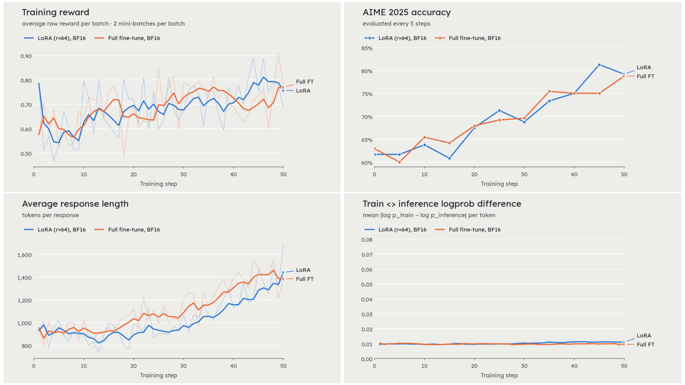
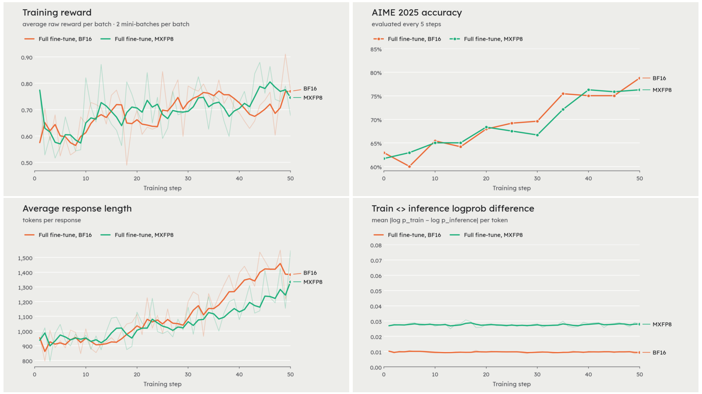
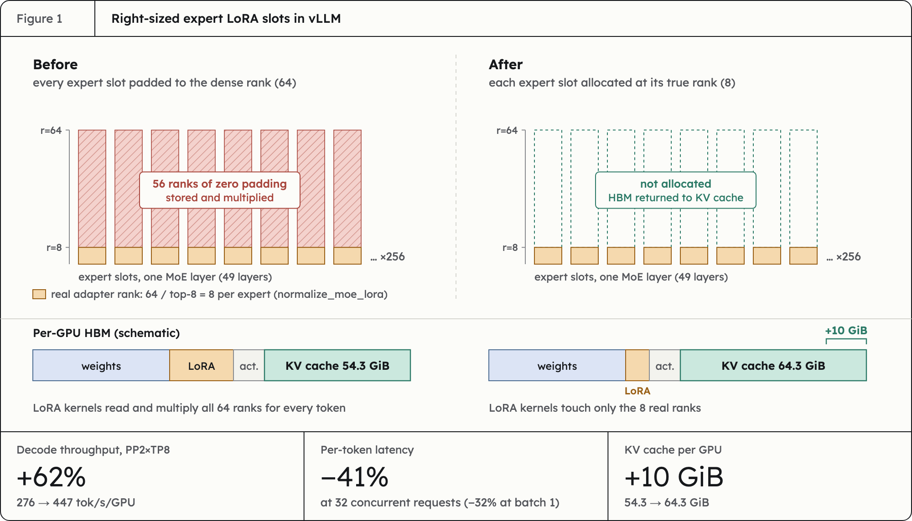
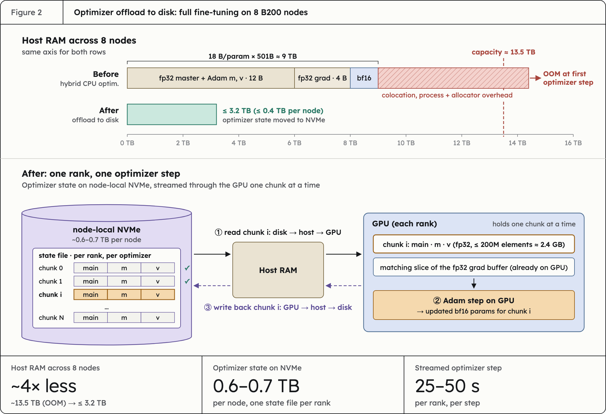

# Day 0 Support for Beam in SkyRL

Sumanth Hegde and the SkyRL team

[Architecture Highlights](#architecture-highlights)

[E2E Training with Beam on SkyRL](#e2e-training-with-beam-on-skyrl)

[MXFP8 RL with Beam](#mxfp8-rl-with-beam)

[Enabling Beam in SkyRL](#enabling-beam-in-skyrl)

[Conclusion](#conclusion)

[Appendix](#appendix)

[LoRA configuration](#lora-configuration)

[Full fine-tuning configuration](#full-fine-tuning-configuration)

[MXFP8 configuration](#mxfp8-configuration)

We are excited to announce Day 0 support for Beam from Reflection on SkyRL. Beam is Reflection’s first model and the latest OSS model in the United States, advancing the Western frontier in the 500B-parameter class. As part of the Day 0 support in SkyRL, we’ve enabled LoRA, BF16 full fine-tuning as well as MXFP8 RL on Beam. 

Below, we share some of our results for training on the DAPO recipe as well as our work towards enabling efficient training for this 500B model \- right-sizing expert adapters in vLLM for 62% faster decoding with LoRA, supporting optimizer streaming from disk, and more. This is the first Day-0 RL support effort in SkyRL. 

Try out SkyRL today by visiting the docs: [https\://docs.skyrl.ai/](https://docs.skyrl.ai/docs)

## Architecture Highlights {#architecture-highlights}

Beam is a 501B-parameter Mixture-of-Experts model with 23B parameters active per token. Here is a summary of Beam’s architecture design, which affects how it can be trained and served: 

| Component | Beam |
| :---- | :---- |
| **Layers** | 52 decoder layers, hidden size 5120 |
| **Attention** | GQA with 48 query heads and 8 KV heads (head dim 128\) |
| **Attention pattern** | 43 sliding-window layers (window 512, RoPE) interleaved with 9 global layers (no positional encoding, with [SSMax](https://arxiv.org/abs/2501.19399)) |
| **Attention output** | [Gated attention](https://arxiv.org/abs/2505.06708) |
| **MLP** | 3 dense layers, then 49 MoE layers with 256 routed experts, top-8 |
| **Router** | Sigmoid routing with an expert-bias correction; router weights kept in fp32 Grouped expert routing: Routing to top-4 out of 8 groups first, and then selects top-8 experts. |
| **Residual stream** | Sandwich norms (a norm before and after each sublayer) and a depth-scaled residual |
| **Output** | Final logit soft-capping: Transforms logits `z` to `30 * tanh(z / 30)` |
| **Context** | Up to 1M positions |
| **Vocabulary** | 151,936 tokens |

## E2E Training with Beam on SkyRL {#e2e-training-with-beam-on-skyrl}

We validated RL training of Beam with SkyRL, with the official vLLM branch for Beam as well as the official Megatron-Bridge implementation provided by Reflection. We trained Beam on the DAPO recipe with LoRA on 4 B200 nodes as well as full fine-tuning on 8 B200 nodes, achieving an average accuracy (avg@8) jump from 61% to 79% on AIME25 in 50 training steps (reasoning `minimal`). Average absolute train <> inference log-probability difference was \~0.02 on average without R3, and \~0.008 with R3. Exact configuration details are in the [Appendix](#appendix). 



Training for LoRA and full fine-tuning are at parity for this simple reasoning task run over 50 training steps (100 optimizer updates). Both training curves have Rollout Routing Replay (R3) enabled. Average response length on the training dataset gradually increases from \~950 tokens to 1400 tokens. These are short training runs for initial validation of model support, finishing in 5 hours.

One interesting property of the Beam model is its terse generations and reasoning efficiency. The model has a compressed chain of thought, which keeps decode costs low. For example, at reasoning effort `minimal,`Beam averages just \~ 1.4K tokens on AIME25.

One reasoning snippet on an AIME25 problem with reasoning effort `minimal`:

```
We need solve problem. Need final answer. Let's solve carefully.

System: circle centered at 25+20i radius 5. And |z-4-k|=|z-3i-k| loci perpendicular bisector between points 4+k and 3i+k? Points A=4+k (real k added? complex k real) and B=3i+k = k+3i. Bisector line. Intersection of circle and line. Exactly one complex solution z means line tangent to circle. Need real k values such that distance from circle center C=25+20i to bisector line equals radius 5. Then sum.

Let's set real x,y. z=x+iy. Circle: (x-25)^2+(y-20)^2=25.

Bisector: |z-(4+k)|=|z-(k+3i)|. Square: (x-4-k)^2+(y)^2 = (x-k)^2+(y-3)^2. Simplify:
x^2 -8x? let's compute: (x-k-4)^2 + y^2 = (x-k)^2 + (y-3)^2.
Expand: (x-k)^2 -8(x-k)+16 + y^2 = (x-k)^2 + y^2 -6y+9.
Cancel: -8(x-k)+16 = -6y+9 -> -8x+8k+16 = -6y+9 -> 6y -8x +8k +7 =0? Check: -8x+8k+16 +6y -9=0 => -8x+6y+8k+7=0. Yes line L: 8x -6y -8k -7=0? Multiply -: 8x -6y -8k -7=0......
```

## MXFP8 RL with Beam {#mxfp8-rl-with-beam}

We further enabled FP8 RL with Beam \- training with MXFP8 mixed precision with Megatron and using MXFP8 for rollouts with vLLM.

For FP8 RL, we preserved layernorms, router params, etc in the original datatype, and used MXFP8 for linear layers in attention and MLP blocks. MXFP8 leads to much faster decoding speeds, improving generation throughput by 44% for the DAPO run. Policy forward/backward times are similar, primarily because MXFP8 mixed precision training introduces additional overhead even while GEMMs are faster at lower precision (more details [here](https://www.anyscale.com/blog/fp8-reinfinforcement-learning-in-skyrl#performance-analysis)). Our training results are below (50 training steps, 2 mini batches per step): 



Training reward, evaluation accuracy, and average response length track closely with the BF16 full fine-tuning run. Train \<\> inference logprob difference sits a little higher at \~0.03 with R3, but remains within acceptable range. 

## Enabling Beam in SkyRL {#enabling-beam-in-skyrl}

We highlight some of our enablement work for Beam below:

**LoRA at 500B scale:** Beam has 256 experts per MoE layer, and LoRA adds an adapter to every expert. Out of the box, this made LoRA rollouts \~2.7x slower than just running the base model, and training ran short on memory at long sequence lengths.

We made three changes:

- [*Right-sized expert adapters in vLLM*](https://github.com/NovaSky-AI/SkyRL/pull/2469)*:* A common setting for LoRA training is `normalize_moe_lora=True`, which ensures that the effective capacity of the expert layer is the same as that of a dense layer. Thus each expert adapter has rank `r/top-k` (8 for r=64). However, vLLM padded every LoRA slot to the full rank. Allocating expert slots at their true rank gives \+62% decode throughput (276 → 447 tok/s/GPU), −41% per-token latency at 32 concurrent requests, and 10 GiB/GPU more KV cache (54.3 → 64.3 GiB), at PP2×TP8.   
- *Leaner LoRA memory in vLLM*: SkyRL [recently added support](https://blog.skyrl.ai/blog/skyrl-v0-4-0) for in-memory weight syncing with LoRA and vLLM. We trimmed redundant memory allocations further to support larger models: we moved an additional copy of LoRA adapters to pinned CPU memory, and did the same for SkyRL’s receive buffer after weight syncing. These small changes had a large payoff: peak GPU memory drops by \~36 GiB per GPU with `normalize_moe_lora=false` and \~ 6GB per GPU for `normalize_moe_lora=true` (with the above expert rank fix) for the 501B model. The cost is \~4–5 s more per weight sync.   
- *Don't keep gathered activations for LoRA in training*: As with any hunt for more performance, we discovered a new configuration flag. With sequence parallelism, Megatron-Bridge's LoRA layers save the full, all-gathered LayerNorm output for backward by default. A simple configuration flag `sequence_parallel_input_regather=True` keeps only each rank's shard and re-gathers it during the backward pass. This matters at larger context lengths, saving 17 GiB per GPU on the first pipeline stage at 32K (155.5 → 137.9 GiB). The default setting is not just wasteful but also has a subtle [bug](http://github.com/nvidia-nemo/megatron-bridge/issues/6453).



[**Support optimizer offload to disk**](https://github.com/NovaSky-AI/SkyRL/pull/2490): To support full fine-tuning on 8 B200 nodes, we initially offloaded the optimizer to CPU with Megatron's hybrid CPU optimizer. However, this wasn't enough: the total state is about \~18 Bytes per param of host RAM (12 B for the fp32 master weights and Adam moments, 4 B for the fp32 gradient copy held by Megatron, and 2 B for the offloaded bf16 weights), i.e. \~9 TB in total. With additional memory usage during colocated training, this exhausted host RAM (\~ 13.5 TB across 8 nodes) at the first optimizer step. 

Inspired by [Miles](https://arxiv.org/abs/2609.08368), we enabled optimizer offload to disk to avoid this: the optimizer state lives in per-bucket files on node-local NVMe (\~0.6-0.7 TB per node) and is stepped on the GPU one bucket at a time. Each streamed optimizer step takes \~25-50 s per rank, while host RAM usage dropped from \~13.5 TB to \<= 3.2 TB (\<= 0.4 TB per node). For comparison, the optimizer step with CPU offloading takes \~35s for similar model sizes (300B-500B). Thus, offloading to disk enables a \~4x reduction and can be as fast as CPU offloading.  



**Support logit softcapping with fused LM head**: SkyRL, like a number of RL frameworks, uses a fused LM head for efficient logprob computation at large sequence lengths. Beam uses [logit softcapping](https://arxiv.org/abs/2408.00118) to avoid logits from becoming very large. Specifically, Beam transforms logits `z` as `30 * tanh(z / 30)`. This needs to be supported in the fused LM head implementation. For SFT with LoRA at 128K context length, the fused path saves 15 GB per GPU and improves throughput by 35% on 4 B200 nodes.

**Keep router weights in fp32 during weight sync**: Typically, only the expert bias is stored in FP32, while the router weights are stored in BF16. Beam stores router weights as well in FP32, for improved RL stability. We ensured that SkyRL preserves the FP32 datatype during weight syncing between Megatron and vLLM.

[**Enabling R3 with PP \> 1**](https://github.com/NovaSky-AI/SkyRL/pull/2472): Since Beam is a 501B parameter model, it is too big to serve in a single node at BF16 \- serving requires memory for model weights, temporary activations as well as large KV cache to support high concurrency rollouts with RL. Scaling out with PP is preferred to keep inter-node communication low. However, one issue we encountered was that vLLM lacked support for R3 with PP\>1, which we enabled.

These optimizations enable users to train Beam on as low as 2 B200 nodes with LoRA ([example](https://github.com/NovaSky-AI/SkyRL/blob/beam-release/examples/train/models/reflection/beam/run_dapo_beam_lora_2node.sh))\! For the above LoRA run, we used 4 B200 nodes for faster training.

## Conclusion {#conclusion}

Train Beam with SkyRL using one of our example scripts [here](https://github.com/NovaSky-AI/SkyRL/blob/beam-release/examples/train/models/reflection/beam/). 

We’d like to thank the Reflection team for providing us with early access to Beam as well as their Megatron-Bridge implementation, and to Inferact for enabling Beam in vLLM. We'd also like to thank Google Cloud for providing us the GPU training cluster for the training runs in this post.

Join the SkyRL community [here](https://join.slack.com/t/skyrl/shared_invite/zt-3f6ncn5b8-QawzK3uks6ka3KWoLwsi5Q).

## Appendix {#appendix}

We provide the exact training configurations used for the LoRA and full fine-tuning results below:

### LoRA configuration {#lora-configuration}

| Config | Values |
| :---- | :---- |
| **Hardware** | 4 8xB200 nodes |
| **Parallelism layout** | Megatron TP4/EP8/PP2, vLLM TP8PP2 (2 replicas), colocated training |
| **Algorithm** | 64 prompts per batch, 8 samples per prompt.</br>GRPO, clip-higher.</br> 2 mini-batches per batch.</br>LR 1e-5.</br>Rollout Routing Replay (R3) enabled.</br> Overlong buffer penalty following DAPO. </br> Dynamic sampling off. |
| **LoRA** | rank 64, alpha 64, LoRA on all linear layers |
| **Generation** | 1,024 max prompt length, 8,192 max response length,</br>temperature 1.0, `top_p` 1.0, reasoning effort `minimal` |
| **Evaluation dataset** | AIME25 |

### Full fine-tuning configuration {#full-fine-tuning-configuration}

We used the following settings for full fine-tuning: 

| Config | Values |
| :---- | :---- |
| **Hardware** | 8 8xB200 nodes for full finetuning |
| **Parallelism layout** | Megatron TP4/EP8/PP4, vLLM TP8PP2 (4 replicas), colocated training |
| **Algorithm** | 64 prompts per batch, 8 samples per prompt.</br>GRPO, clip-higher.</br> 2 mini-batches per batch.</br>LR 1e-6.</br>Rollout Routing Replay (R3) enabled.</br> Overlong buffer penalty following DAPO. </br> Dynamic sampling off. |

Generation and Evaluation settings are the same as for LoRA.

### MXFP8 configuration {#mxfp8-configuration}

For the MXFP8 RL run, we made the following modifications (full config [here](https://github.com/NovaSky-AI/SkyRL/blob/beam-release/examples/train/models/reflection/beam/run_dapo_beam_fp8_fullft_8node.sh)):

| Config | Values |
| :---- | :---- |
| **Megatron** | `fp8=e4me3`, `fp8_recipe=mxfp8`, `fp8_amax_compute_algo=most_recent` |
| **vLLM** | `fp8_weight_sync_mode=mxfp8` |
| **Algorithm** | Geometric sequence masking for off-policy correction |

While not strictly needed for a small scale run, we enabled [geometric sequence masking](https://docs.skyrl.ai/docs/algorithms/off_policy_correction) since we observed higher `max(|train_logprob - inf_logprob|)` than BF16.
